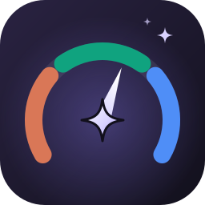
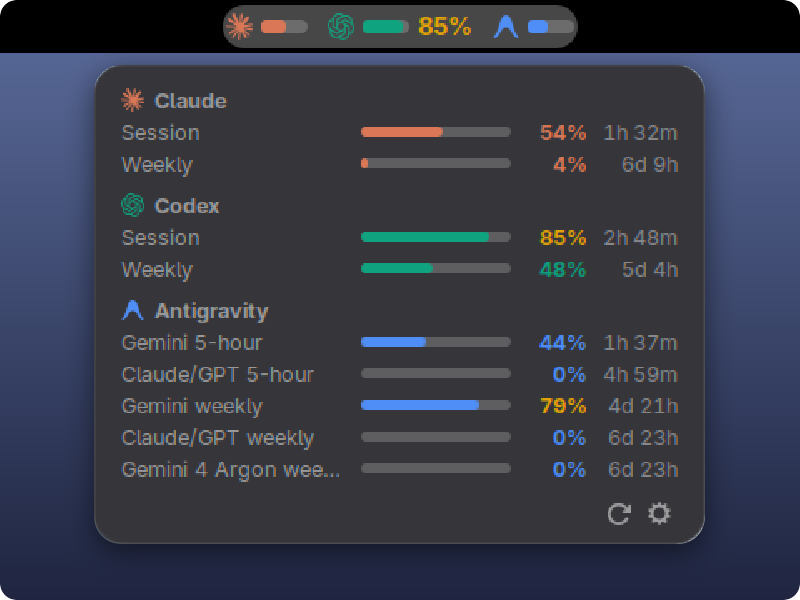
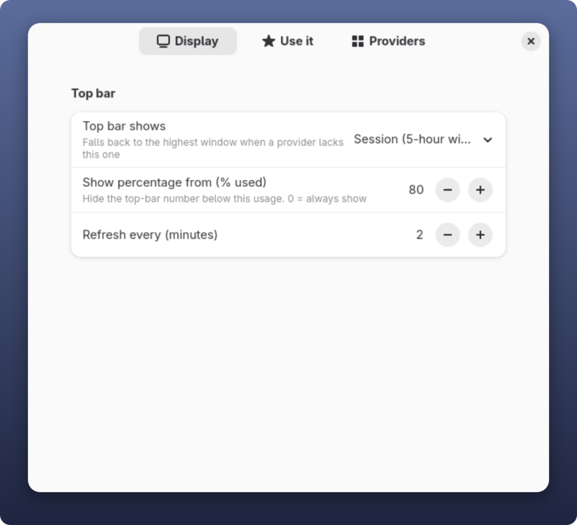
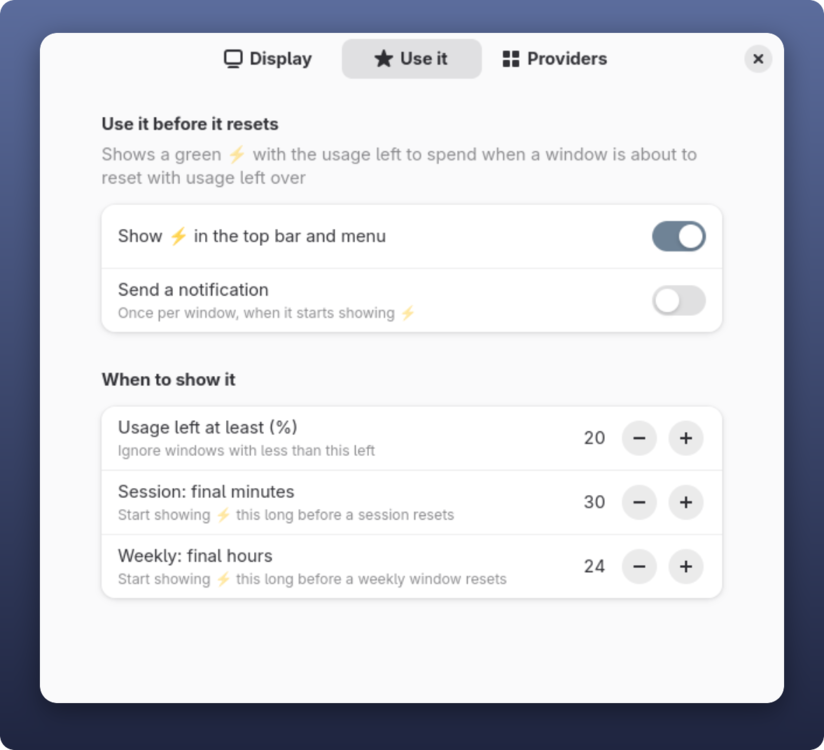
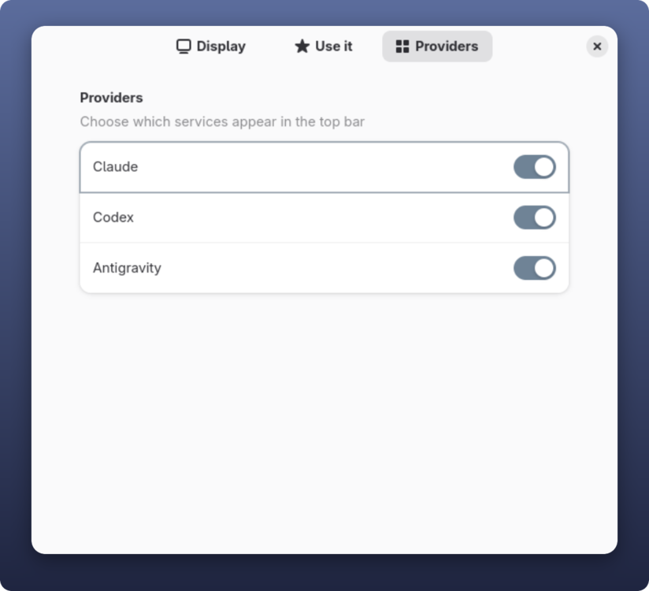

<p align="center">
  
</p>

# AI Usage Meter — GNOME Shell Extension

**Your Claude, Codex and Antigravity limits, always in sight in the GNOME top bar.**

> 🚧 **Work in progress.** It works well on my machine every day, but it is young: expect rough edges, missing providers and changes between releases. Feedback, issues and pull requests are very welcome.

<p align="center">
  
</p>

## Why

I use several AI coding assistants every day, and each one has its own rate limits: a session window that resets every few hours, a weekly cap, sometimes a separate one per model. I kept getting cut off in the middle of work, or noticing too late that a window was about to reset with a big part of it still unused.

I looked for a GNOME extension that showed all of this at a glance and couldn't find one I liked, so I built it.

## What it does

- **One small bar per provider** in the top bar, in the provider's color, so you can see how much you've used without opening anything. The percentage appears once you pass a threshold, turning yellow, then red, as you get close to the limit.
- **A menu with every rate window** (session, weekly, per model) and the countdown to its reset.
- **Use it before it resets:** a green ⚡ with the percentage still left appears when a window is about to reset with usage left over, with an optional notification. No more wasted quota.
- **Locked:** a red lock and the time to reset replace the bar when a weekly window is used up.
- **Honest when it doesn't know:** a sleeping moon instead of a misleading empty bar when a provider can't be read (for example when Antigravity isn't signed in).
- **Configurable:** pick the providers, which window the bar follows, the refresh interval and the ⚡ thresholds.

The extension never reads or stores your API keys or logins: it only runs [`codexbar`](https://github.com/steipete/CodexBar), which uses the sign-ins of the apps themselves.

## Install

**1. Install `codexbar`** (the extension reads your usage through it), then sign in to the providers you use:

```sh
brew install steipete/tap/codexbar
```

**2. Install the extension** with one command:

```sh
curl -fsSL https://raw.githubusercontent.com/poriol/gnome-shell-extension-ai-usage-meter/main/install.sh | bash
```

**3. Log out and back in.** The meter appears in the top bar.

That's it. Run the same command again any time to update to the latest version.

Requires **GNOME Shell 50 or 51**.

<details>
<summary>Install by hand instead</summary>

Download `ai-usage-meter.zip` from the [latest release](https://github.com/poriol/gnome-shell-extension-ai-usage-meter/releases/latest), then:

```sh
gnome-extensions install --force ai-usage-meter.zip
```

Log out and back in, then:

```sh
gnome-extensions enable ai-usage-meter@poriol.github.io
```

</details>

<details>
<summary>Install from source</summary>

```sh
git clone https://github.com/poriol/gnome-shell-extension-ai-usage-meter ~/.local/share/gnome-shell/extensions/ai-usage-meter@poriol.github.io
glib-compile-schemas ~/.local/share/gnome-shell/extensions/ai-usage-meter@poriol.github.io/schemas
```

Log out and back in, then `gnome-extensions enable ai-usage-meter@poriol.github.io`.

</details>

<details>
<summary>Uninstall</summary>

```sh
gnome-extensions uninstall ai-usage-meter@poriol.github.io
```

</details>

## Settings

Open them from the ⚙ button at the bottom of the menu, or with `gnome-extensions prefs ai-usage-meter@poriol.github.io`.

<table>
  <tr>
    <td align="center"><a href="docs/settings-display.png"></a><br><b>Display</b><br>What the top bar shows and how often it refreshes</td>
    <td align="center"><a href="docs/settings-use-it.png"></a><br><b>Use it</b><br>When the ⚡ “use it before it resets” hint appears</td>
    <td align="center"><a href="docs/settings-providers.png"></a><br><b>Providers</b><br>Which services appear in the top bar</td>
  </tr>
</table>

## Contributing

This is a personal project in progress. If something breaks, a provider is missing or you have an idea, open an issue or a pull request.

### Releasing (maintainers)

Push a tag and GitHub Actions builds `ai-usage-meter.zip` and publishes it as a release:

```sh
git tag v1 && git push origin v1
```

## License

[GPL-2.0-or-later](LICENSE)
